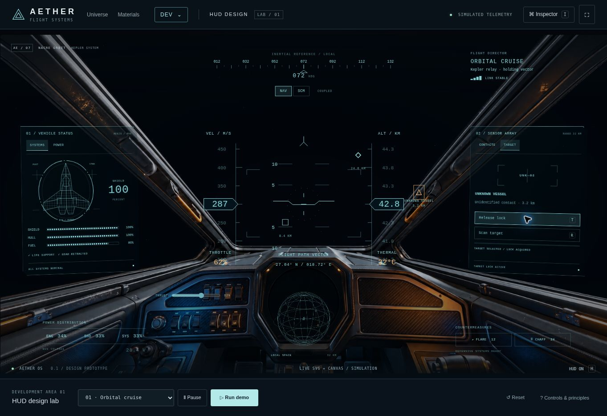
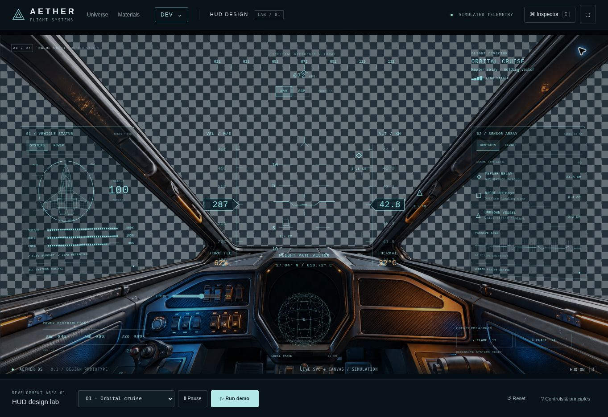

# Aether HUD design lab

Entry: `hud-design.html`, also available through **DEV → HUD design** from the planet explorer, material editor and renderer preview. The HUD is an independent interface prototype with illustrative telemetry. It does not control the planet renderer, simulate spacecraft physics or display genuine engine performance measurements.



## Try it

- **Run demo**: a 35-second guided sequence covering cruise, an unknown contact, target acquisition, identification, an emergency, power redistribution and surface approach. Pause also pauses the guided timeline. Stop returns control at the current state.
- Choose one of four scenarios. Scenario changes clear the previous target, scan and warning acknowledgement.
- Click a projected marker or a sensor contact. Acquire/release a lock and initiate a four-second scan. The unknown contact resolves to an illustrative civilian transponder.
- Change thrust to see speed respond smoothly. NAV has an unrestricted demo speed; SCM caps the requested speed at 200 m/s. This is a demo control law, not flight physics.
- Open **POWER** or click the bottom power summary. Energy is conserved at 100%. Engine allocation changes speed; shield allocation influences the simplified thermal response. This intentionally does not imply a complete engineering simulation.
- Deploy flare/chaff countermeasures. Inventory is finite and the launcher has a 1.2-second cooldown. Reset restores inventory.
- Acknowledge a warning to remove its banner. The degraded system readout remains visible.
- Open **Inspector** to adjust colour, scale, intensity, panel backing, backdrop exposure, safe area, reduced decorative motion and high contrast. Preferences use versioned browser-local storage and can be exported as JSON. Invalid numeric/profile settings are bounded; unavailable storage leaves session controls functional. Preset import is not implemented.
- **Space**: pause; **T**: select/lock; **R**: scan; **I**: inspector; **H**: HUD visibility; **Escape**: close a panel. Native controls keep their keyboard behaviour; shortcuts do not override form fields, buttons or menus.

## Visual and interaction principles

1. **Prioritise the flight path.** Keep centre geometry minimal. Velocity, altitude, flight direction and immediate hazards have the strongest hierarchy. Dense system details stay on peripheral multifunction displays.
2. **Use predictable spatial anchors.** Top heading, left vehicle health, right sensors, bottom radar. Avoid random HUD jitter and large decorative animation during a task.
3. **Make the UI real.** Native buttons, inputs and select elements provide focus and keyboard handling. SVG renders readable flight labels and scalable instrument geometry; canvas handles the starfield and decorative spherical radar. The transparent cockpit foreground contains no baked-in functional readouts.
4. **Use stateful, reversible interactions.** A target is selected, locked, scanned, then identified. A warning can be acknowledged without restoring the underlying system. Each action has visible status, controls that reflect state and a concise live announcement.
5. **Protect legibility.** Colour alone never identifies a contact or a warning: use distinct marker shapes, words and percentages. Preserve text contrast against both space and terrain; dark panel backing and a high contrast profile support adjustment. A screenshot is not a contrast audit. A production HUD should verify 4.5:1 for normal text and 3:1 for essential graphical elements across expected backgrounds.
6. **Provide configurable presentation.** Scale, backing and colour are independent. Respect the system reduced-motion preference by default, with a user override. This stops decorative star/radar motion and perspective skew while maintaining telemetry. A separate pause stops simulation and the guided tour.
7. **Keep input targets usable.** Interactive controls have intentional target areas; contact markers are at least 44 × 44 CSS pixels. Desktop dense controls are generally 28–38 px high. Very small decorative text is secondary and should be revisited against viewing-distance requirements when the cockpit is integrated into gameplay.
8. **Adapt the information layout.** Mobile stacks the central flight view above two compact system panels; the top DEV navigation and scenario controls remain usable. The interface does not simply shrink a desktop screenshot.
9. **Separate UI and simulation.** `hud/state.js` is renderer independent. `main.js` connects commands to presentation. `canvas.js` only draws the decorative starfield and spherical radar. The draw loop pauses work in hidden tabs and bounds time steps after stalls. Telemetry presentation is sampled at 20 Hz with unchanged text/HTML and tape rebuilds skipped; there are no additional frameworks, CDNs or API calls on this page.
10. **Verify in context.** Test normal, warning, critically degraded and paused states; target selection and scan cancellation; power conservation; minimum and maximum appearance settings; portrait and landscape; keyboard focus and reduced motion. Before engine integration, test bright terrain, night, overcast, rapid camera turns, aspect ratios, colour vision differences and actual GPU budgets.

## Integration boundary

The cockpit is a reference-based transparent foreground image over a separate animated starfield canvas. There is no baked-in planet or sky in the active foreground. It is not a mesh cockpit and the projected contacts are illustrative fixed screen anchors. Radar contacts are decorative representations, not actual world projections. Heading and altitude are fixed by scenario; speed, heat and scan progress respond live. In-engine integration should replace these with a versioned telemetry adapter and camera-derived projections, without changing the state/command boundary.

Recommended next integration contract:

```js
// Plain numbers in SI units; updates originate in the engine.
{velocityMps, altitudeMetres, headingDegrees, pitchDegrees,
 shieldFraction, hullFraction, fuelFraction, temperatureCelsius,
 contacts: [{id, positionWorld, rangeMetres, classification}], alerts: []}
// Commands are emitted toward the engine; UI never mutates render internals.
// selectTarget(id), lockTarget(id), scanTarget(id), setThrottle(fraction),
// setPowerAllocation({engines, shields, systems}), deployCountermeasure(type)
```

Keep projected marker positions in a display adapter. Use edge indicators for offscreen targets and depth/occlusion rules for world anchors. Move expensive graphs to canvas/WebGL only when measured, retaining semantic equivalents for interactive controls. Do not move readable labels into the cockpit texture.

## Asset provenance and segmentation

The active cockpit asset is `dist/hud/assets/cockpit-foreground.webp`, a lossless RGBA foreground extracted from the earlier `cockpit-clean.webp` using the built-in image generation editor. The source and the full composition are preserved as references. The active asset contains the physical canopy supports and dashboard, with all three open window regions transparent; the planet, horizon, starfield and nebula have been removed. It is a 2D cutout, not a 3D mesh or depth reconstruction.

| Layer | Implementation | Inspection |
| --- | --- | --- |
| Scene background | Independent solid field and starfield canvas | Choose starfield, black or checkerboard in Inspector |
| Cockpit foreground | Lossless alpha WebP, 1678 × 937 | Toggle foreground visibility; download the cutout |
| HUD instruments | Native controls, SVG instruments and radar canvas | Existing HUD visibility toggle |

The window alpha was sampled at the top centre, forward window, former horizon and both side windows; these samples are fully transparent (alpha 0). Physical surfaces remain near-opaque, with antialiased extraction edges. Roughly 55.9% of the image pixels are fully transparent. No glass tint or reflections have been retained across the open windows. The original `cockpit-clean.webp` has a baked planet but is no longer referenced by the runtime page or stylesheet.

Segmentation prompt: “Extract only the physical cockpit interior foreground onto genuine transparent RGBA. Preserve the exact composition, 1678:937 canvas, camera, metal supports, window seals, dashboard, carbon panels, switches and practical lights. Remove all planet, horizon, stars, nebula and sky through all three window openings; make the empty openings transparent, including the former bright blue planetary limb. Preserve mechanical silhouettes and surface detail, with crisp antialiased edges. No added glass haze, HUD, labels or symbols.”



The foreground retains the shared design-frame alignment. The independent background can later be replaced by a game-rendered scene; no engine coordinate or renderer integration has been performed here.

## Verification

`node scripts/test-hud.mjs` verifies power conservation, pause/scan timing, scenario isolation, throttle response, SCM limiting and thermal response. It is included in `npm test`; all HUD modules are included in `npm run check`. Browser QA covers the rendered page and interactive target, power, inspector, warnings and guided demo behaviour. There is no screenshot upload pipeline.

## Primary references

- [Xbox Accessibility Guideline 101: Text display](https://learn.microsoft.com/en-us/gaming/accessibility/xbox-accessibility-guidelines/101)
- [Xbox Accessibility Guideline 102: Contrast](https://learn.microsoft.com/en-us/gaming/accessibility/xbox-accessibility-guidelines/102)
- [W3C WCAG 2.2: Target Size (Minimum)](https://www.w3.org/WAI/WCAG22/Understanding/target-size-minimum)
- [W3C WCAG 2.2: Pause, Stop, Hide](https://www.w3.org/WAI/WCAG22/Understanding/pause-stop-hide)

This prototype is not a WCAG conformance claim and is not affiliated with Star Citizen or Cloud Imperium Games.


## Aspect ratio stability

The desktop cockpit uses a single 1678 × 937 design frame matching the art plate. A ResizeObserver uniformly fits and centres the entire frame inside the available viewport; the artwork, compass, instruments, projected contacts and radar therefore share exactly the same transform. Spare space stays outside the frame instead of cropping cockpit controls. The central flight display is anchored by the actual SVG reticle at (360,237), including when the HUD scale changes. Independent width caps and viewport-height sizing no longer move HUD components relative to one another. Portrait windows up to 900 px wide use the existing reflow layout; short landscape windows retain the fitted cockpit and compact outer toolbars.
